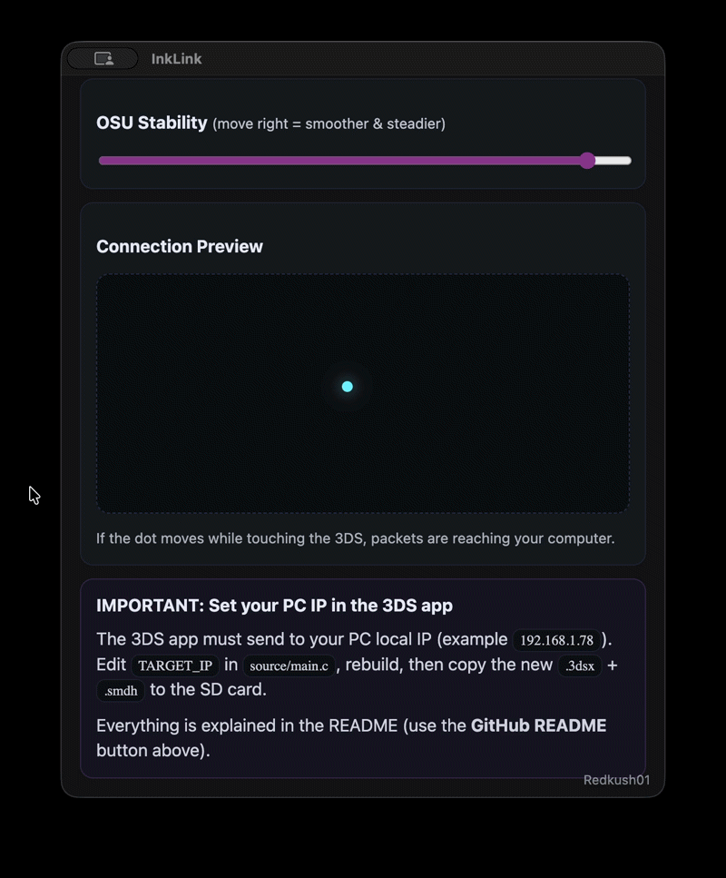
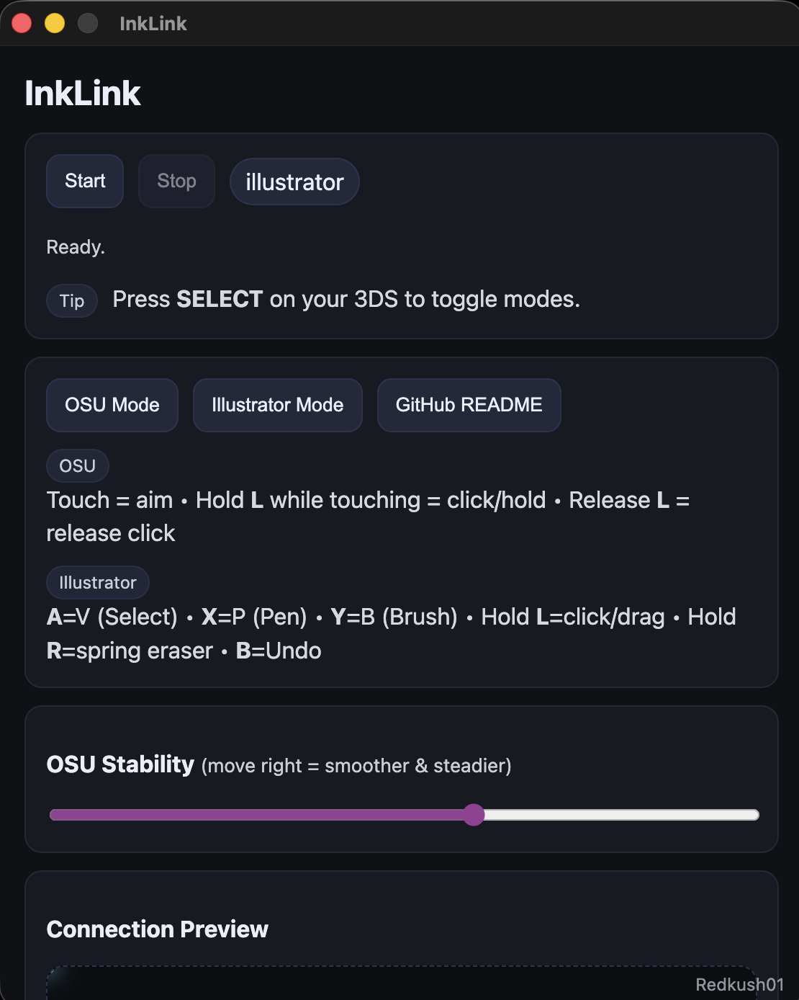
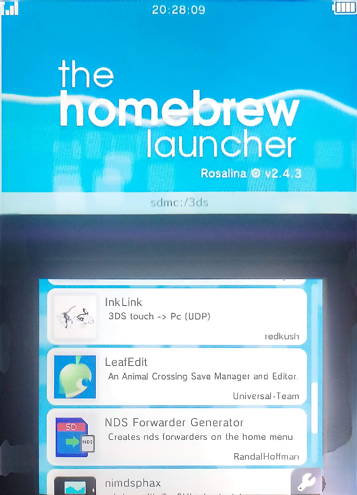

# InkLink

<p>
  <a href="https://github.com/Redkush01/InkLink/releases/latest">
    
  </a>
</p>

<p>
  <a href="LICENSE">
    
  </a>
</p>

## Download

Get the latest version from **Releases**:
- **Desktop App** (macOS / Windows)
- **Nintendo 3DS app** (SD-ready zip)

## Quick Start

1. Download InkLink Desktop from **Releases** and run it.
2. On first run, allow required permissions:
   - macOS: **System Settings → Privacy & Security → Accessibility**
   - Windows: allow InkLink through Firewall if prompted
3. Click **Start** in the Desktop app (UDP listener).
4. Put the 3DS app on your SD at `/3ds/inklink-3ds/` and launch it from **Homebrew Launcher**.
5. Touch the 3DS screen → the preview dot should move on Desktop.
6. Press **SELECT** on the 3DS to switch modes (osu!/Illustrator).

> Tip: Make sure your PC and 3DS are on the same Wi-Fi network.

Turn your **modded Nintendo 3DS** into a lightweight touch input device for **osu!** and creative apps (Illustrator/Figma) over Wi-Fi (UDP).

## Demo



## Screenshots



> ✅ **Required:** a **modded 3DS** with **Homebrew Launcher** (able to run `.3dsx` homebrew).  
> ❌ If your 3DS is not modded / has no Homebrew Launcher, InkLink will not work.

---

## What InkLink does

InkLink has two parts:

- **3DS homebrew app**: reads touchscreen + buttons and sends data over UDP
- **Desktop app (macOS/Windows)**: receives data and controls mouse/keyboard

### Modes & Controls

#### OSU! Mode
- **Touch** = aim cursor
- Hold **L** while touching = **click/hold** (streams / sliders)
- Release **L** = release click
- Press **SELECT** = toggle mode (also updates the desktop UI)

#### Illustrator Mode
- **A** → Selection (**V**)
- **X** → Pen (**P**)
- **Y** → Brush (**B**)
- Hold **L** → click/drag (drawing + moving points)
- Hold **R** → spring eraser (**Shift+E**), release **R** → back to last tool
- **B** → Undo (**Ctrl/Cmd + Z**)

---

## Requirements

### Nintendo 3DS
- **Modded Nintendo 3DS / New 3DS**
- **Homebrew Launcher** installed and working
- SD card access (to copy files)

### PC
- macOS or Windows
- Both 3DS and PC must be on the **same Wi-Fi**
- Firewall must allow **UDP port 4545**

---

## Installation — 3DS (Homebrew Launcher)

You must copy the InkLink 3DS app to your SD card so it appears in Homebrew Launcher.

### SD card structure

Create this folder: 

- `/3ds/inklink-3ds/`

Put these files inside:

- `inklink-3ds.3dsx`
- `inklink-3ds.smdh` (icon + metadata)

Final result:
- `/3ds/inklink-3ds/inklink-3ds.3dsx`
- `/3ds/inklink-3ds/inklink-3ds.smdh`

Then:
1) Insert the SD into your 3DS
2) Open **Homebrew Launcher**
3) Launch **InkLink**

> Tip: If the icon doesn’t update, exit/re-enter Homebrew Launcher or reboot the 3DS.



---

## IMPORTANT — Set your PC IP in the 3DS app ⚠️

InkLink works only if your 3DS sends packets to your computer’s **local IP address** (example: `192.16x.1.xx`).

### Find your IP

- **macOS:** System Settings → Network → Wi-Fi → Details → **IP Address**
- **Windows:** Settings → Network & Internet → Wi-Fi/Ethernet → Properties → **IPv4 address**
- Or terminal/cmd: `ifconfig` (macOS) / `ipconfig` (Windows)

### Set it in `main.c`
On your PC, open the 3DS homebrew project and edit:

**source/main.c**
and find the lines:

```c
#define TARGET_IP "192.xxx.x.xx"
#define TARGET_PORT 4545
```
**Replace the IP with your current PC IP, then rebuild and copy the updated .3dsx + .smdh to the SD card.**
*Leave the port as 4545 unless you changed it in the desktop app too.*

**Rebuild the 3DS homebrew**

In the 3DS project folder, run:
```c
gmake clean
gmake
```
This will generate updated files, typically:

- `inklink-3ds.3dsx`
- `inklink-3ds.smdh`

**LAST STEP: Copy the updated files to your SD card**

Place them here:

- `/3ds/inklink-3ds/`.

**Desktop App (macOS / Windows)**
1. Open InkLink
2. Press Start
3. Launch InkLink on the 3DS
4. Touch the 3DS screen:
**If the preview dot moves, the connection is OK**

*macOS permissions* (required for mouse/keyboard control)

System Settings → Privacy & Security → Accessibility

**IMPORTANT**:Enable InkLink (or “Electron” while developing).
If it still doesn’t move: toggle off/on and restart InkLink.

*Windows firewall*

When prompted, allow InkLink through Windows Firewall (Private network).
If no prompt appears: Windows Security → Firewall → “Allow an app”.

⸻

**Troubleshooting**

*Dot doesn’t move:*
- wrong TARGET_IP
- different Wi-Fi networks
- firewall blocking UDP 4545

*Dot moves but cursor doesn’t:*
- macOS Accessibility not enabled
- OS security blocking input control

*Feels shaky / jittery (osu!)*
- increase OSU Stability slider
- improve Wi-Fi signal

*If it worked yesterday, your IP probably changed. DHCP is a drama queen lol*

⸻

Credits

## Troubleshooting

- **No movement / no input**
  - Ensure PC and 3DS are on the same Wi-Fi network.
  - Check firewall allows UDP on port **4545**.
- **macOS: mouse/keys don’t work**
  - Enable **Accessibility** permission for InkLink.
- **Windows: input blocked**
  - Try running InkLink as Administrator and allow it through Windows Firewall.
- **Lag/jitter**
  - Improve Wi-Fi signal, reduce interference, and tweak smoothing/stability settings (if available).

## Credits

Created by **Elena Vasienti** (GitHub: **Redkush01**).

If you redistribute or fork this project, you must keep the original copyright notice and the **MIT License**.
